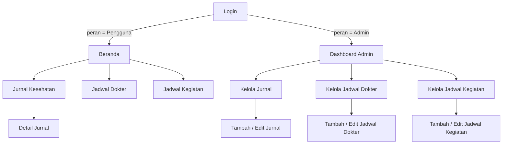
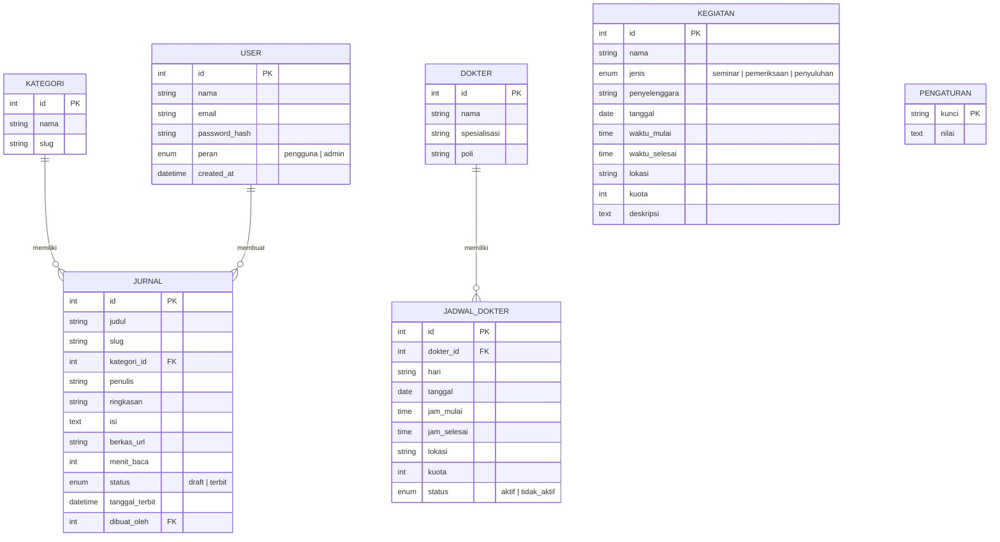

# PRD — Portal Kesehatan Puskesmas Banjar Agung

| Item | Keterangan |
|---|---|
| Nama produk | Portal Kesehatan Puskesmas Banjar Agung ("Jurnal & Jadwal Dokter") |
| Versi dokumen | 1.0 |
| Tanggal | 5 November 2026 |
| Sumber desain | Figma "Jurnal & Jadwal Dokter" (8 frame, `Kapsel/design`) |
| Status | Draft — menunggu review |

---

## 1. Latar Belakang

Informasi kesehatan dan jadwal praktik dokter di Puskesmas Banjar Agung saat ini masih disampaikan secara manual (papan pengumuman, mulut ke mulut, pesan grup). Akibatnya:

- Warga datang saat dokter tidak praktik atau poli sudah penuh.
- Edukasi kesehatan tidak tersampaikan secara rutin dan terdokumentasi.
- Petugas harus berulang kali menjawab pertanyaan yang sama soal jadwal.

Portal ini menyediakan **satu tempat** untuk warga membaca jurnal kesehatan dan melihat jadwal dokter, serta panel bagi petugas untuk mengelola konten tersebut.

## 2. Tujuan & Metrik Keberhasilan

| Tujuan | Metrik | Target 3 bulan setelah rilis |
|---|---|---|
| Warga tahu jadwal dokter sebelum datang | Jumlah kunjungan halaman Jadwal Dokter / minggu | ≥ 300 |
| Edukasi kesehatan rutin | Jurnal terbit per bulan | ≥ 4 artikel |
| Mengurangi pertanyaan berulang ke petugas | Pertanyaan jadwal via telepon/WA (survei petugas) | Turun ≥ 30% |
| Admin mudah memperbarui konten | Waktu membuat 1 jadwal dokter | ≤ 2 menit |

## 3. Pengguna (Persona & Peran)

| Peran | Deskripsi | Kebutuhan utama |
|---|---|---|
| **Pengguna (Warga/Pasien)** | Warga wilayah kerja puskesmas, mayoritas akses lewat HP | Melihat jadwal dokter hari ini/minggu ini, membaca tips kesehatan |
| **Administrator (Petugas)** | Staf puskesmas yang mengelola informasi | Menambah/mengubah jurnal, jadwal dokter, dan jadwal kegiatan dengan cepat |

## 4. Ruang Lingkup

### 4.1 Termasuk (MVP)
1. Autentikasi (login, logout, lupa password) dengan 2 peran.
2. Portal Pengguna: Beranda, Jurnal Kesehatan (daftar + detail), Jadwal Dokter, Jadwal Kegiatan.
3. Panel Admin: Dashboard, Kelola Jurnal (CRUD + draft/terbit + unggah berkas), Kelola Jadwal Dokter (CRUD), Kelola Jadwal Kegiatan (CRUD).

### 4.2 Tidak Termasuk (MVP)
- Pendaftaran/booking antrean online.
- Rekam medis atau data kesehatan pribadi pasien.
- Notifikasi (WA/email/push).
- Aplikasi mobile native (cukup web responsif).
- Multi-puskesmas.

## 5. Peta Halaman

> [!NOTE]
> Halaman yang **belum ada di Figma** dan perlu didesain: Detail Jurnal, Jadwal Kegiatan (pengguna), daftar Kelola Jurnal / Kelola Jadwal / Kelola Kegiatan (tabel), Lupa Password, dan tampilan mobile.

## 6. Kebutuhan Fungsional

Prioritas: **P0** = wajib MVP, **P1** = sebaiknya ada, **P2** = nanti.

### 6.1 Autentikasi — Frame 01

| ID | Kebutuhan | Prioritas |
|---|---|---|
| AUTH-1 | Login dengan email + password. | P0 |
| AUTH-2 | Validasi: email format valid, password wajib diisi; tampilkan pesan error di bawah field. | P0 |
| AUTH-3 | Setelah login, arahkan sesuai peran: Pengguna → Beranda, Admin → Dashboard Admin. | P0 |
| AUTH-4 | "Lupa password?" mengirim tautan reset ke email. | P1 |
| AUTH-5 | Logout dari menu profil (pojok kanan atas). | P0 |
| AUTH-6 | Halaman Pengguna dan Admin hanya bisa diakses setelah login; halaman admin menolak akun Pengguna. | P0 |
| AUTH-7 | Batasi percobaan login (mis. 5x gagal → kunci 15 menit). | P1 |

> [!IMPORTANT]
> Perlu keputusan: apakah Beranda, Jurnal, dan Jadwal **boleh dilihat tanpa login** (publik)? Untuk informasi publik seperti jadwal dokter, akses tanpa login biasanya lebih bermanfaat. Lihat Bagian 12.

### 6.2 Beranda Pengguna — Frame 02

| ID | Kebutuhan | Prioritas |
|---|---|---|
| HOME-1 | Sapaan sesuai waktu ("Selamat pagi/siang/sore/malam, {nama}") + tanggal hari ini. | P0 |
| HOME-2 | Banner "Jaga kesehatan, mulai dari hari ini" dengan tombol **Lihat jadwal dokter**. | P0 |
| HOME-3 | 3 kartu ringkasan: jumlah jurnal pilihan, jumlah dokter praktik hari ini (+ poli), jam pelayanan (+ hari). | P0 |
| HOME-4 | Bagian "Jurnal kesehatan pilihan": 3 jurnal terbaru/pilihan (kategori, judul, ringkasan, "Baca selengkapnya"). Tautan "Lihat semua jurnal". | P0 |
| HOME-5 | Bagian "Jadwal dokter hari ini": kartu per dokter (nama, spesialisasi, jam, status). Tautan "Lihat jadwal lengkap". | P0 |
| HOME-6 | Jika tidak ada dokter praktik hari ini, tampilkan pesan kosong yang jelas. | P0 |
| HOME-7 | Footer sidebar "Butuh bantuan? Hubungi layanan kami" → nomor telepon/WA puskesmas. | P1 |

### 6.3 Jurnal Kesehatan — Frame 03

| ID | Kebutuhan | Prioritas |
|---|---|---|
| JRN-1 | Daftar jurnal berstatus **Terbit** dalam grid kartu (kategori, judul, ringkasan, tanggal terbit, estimasi menit baca). | P0 |
| JRN-2 | Pencarian berdasarkan judul atau topik. | P0 |
| JRN-3 | Filter kategori (chip): Semua, Kesehatan umum, Kesehatan mental, Gizi. Kategori dikelola admin. | P0 |
| JRN-4 | Urutkan: Terbaru dahulu / Terlama dahulu. | P0 |
| JRN-5 | Tampilkan jumlah hasil ("6 jurnal untuk Anda") dan pagination (9 per halaman). | P0 |
| JRN-6 | Halaman **Detail Jurnal**: judul, kategori, penulis, tanggal, isi/berkas (PDF dapat dilihat/diunduh, gambar ditampilkan). | P0 |
| JRN-7 | Estimasi menit baca dihitung otomatis (≈200 kata/menit) atau diisi admin. | P1 |
| JRN-8 | Kondisi kosong saat pencarian tidak menemukan hasil. | P0 |

### 6.4 Jadwal Dokter — Frame 04

| ID | Kebutuhan | Prioritas |
|---|---|---|
| JDW-1 | Tampilan bulan & rentang minggu ("November 2026 · 2–8 November 2026") dengan tombol minggu sebelumnya/berikutnya. | P0 |
| JDW-2 | Strip 7 hari (Senin–Minggu); hari terpilih ditandai; default = hari ini. | P0 |
| JDW-3 | Pencarian nama dokter. | P0 |
| JDW-4 | Filter **Poli** (Semua poli / Poli Umum / Poli Kulit / …) dan **Jam** (Semua jam / Pagi / Siang). | P0 |
| JDW-5 | Tabel jadwal untuk hari terpilih: Nama dokter (+ faskes), Poli/layanan, Jam praktik, Lokasi, Status; beserta jumlah dokter praktik. | P0 |
| JDW-6 | Status: **Tersedia** (aktif & kuota masih ada), **Penuh**, **Tidak praktik/Dibatalkan**. | P0 |
| JDW-7 | Kotak info "Sebelum berkunjung" (KTP/BPJS, jadwal dapat berubah). Teks dapat diubah admin. | P1 |
| JDW-8 | Hanya jadwal berstatus Aktif yang tampil ke pengguna. | P0 |

### 6.5 Jadwal Kegiatan (Pengguna) — *belum ada di Figma*

| ID | Kebutuhan | Prioritas |
|---|---|---|
| KEG-U1 | Menu "Jadwal Kegiatan" di sidebar pengguna. | P0 |
| KEG-U2 | Daftar kegiatan mendatang (nama, jenis, tanggal, waktu, lokasi, penyelenggara, kuota). | P0 |
| KEG-U3 | Detail kegiatan berisi deskripsi lengkap. | P1 |
| KEG-U4 | Kegiatan yang sudah lewat masuk ke tab "Selesai". | P2 |

### 6.6 Dashboard Admin — Frame 05

| ID | Kebutuhan | Prioritas |
|---|---|---|
| ADM-1 | 4 kartu statistik: Jurnal terbit, Draft jurnal, Dokter terdaftar, Jadwal hari ini. | P0 |
| ADM-2 | Kartu aksi cepat: **+ Tambah jurnal kesehatan**, **+ Tambah jadwal dokter** (dan + Tambah kegiatan). | P0 |
| ADM-3 | Tabel "Jurnal kesehatan terbaru" (3 terakhir: judul, kategori, tanggal terbit, status) + tautan "Kelola jurnal". | P0 |
| ADM-4 | Panel "Jadwal dokter hari ini" (nama, spesialisasi, jam, status Aktif) + tautan "Kelola jadwal dokter". | P0 |
| ADM-5 | Badge peran "ADMINISTRATOR" + tanggal hari ini di header. | P0 |

### 6.7 Kelola & Tambah Jurnal — Frame 06

| ID | Kebutuhan | Prioritas |
|---|---|---|
| KJ-1 | Halaman daftar jurnal (tabel) dengan pencarian, filter status (Draft/Terbit), aksi Edit, Hapus, Terbitkan/Tarik. | P0 |
| KJ-2 | Form: **Judul** (wajib, maks. 150 karakter), **Kategori** (dropdown, wajib), **Penulis** (wajib), **Ringkasan** (wajib, maks. 200 karakter), **Unggah Berkas**. | P0 |
| KJ-3 | Unggah berkas drag & drop atau klik; format PDF, DOCX, JPG; maks. 10 MB; tampilkan nama file + tombol hapus. | P0 |
| KJ-4 | Tombol **Simpan sebagai draft** (tidak tampil ke pengguna) dan **Publikasikan jurnal** (langsung tampil). | P0 |
| KJ-5 | Opsional: editor teks isi artikel (rich text) selain berkas. | P1 |
| KJ-6 | Konfirmasi sebelum hapus; notifikasi sukses/gagal setelah simpan. | P0 |
| KJ-7 | Tautan "← Kembali ke dashboard admin". | P0 |

> [!NOTE]
> Field **Ringkasan** belum ada di Figma, padahal kartu jurnal di sisi pengguna menampilkan ringkasan. Disarankan menambahkannya ke form.

### 6.8 Kelola & Tambah Jadwal Dokter — Frame 07

| ID | Kebutuhan | Prioritas |
|---|---|---|
| KD-1 | Halaman daftar jadwal (tabel) dengan filter tanggal/poli, aksi Edit, Hapus, Aktif/Nonaktifkan. | P0 |
| KD-2 | Form: **Nama Dokter**, **Spesialisasi**, **Hari Praktik**, **Tanggal**, **Jam Mulai**, **Jam Selesai**, **Lokasi/Ruangan**, **Kuota Pasien**, **Status Jadwal** (Aktif/Tidak aktif). Semua wajib. | P0 |
| KD-3 | Validasi: jam selesai > jam mulai; kuota ≥ 1; tidak boleh ada jadwal bentrok untuk dokter yang sama. | P0 |
| KD-4 | **Jadwal berulang**: pilih hari (mis. setiap Senin) tanpa tanggal tertentu, ATAU tanggal spesifik (sekali). | P1 |
| KD-5 | Data dokter disimpan sebagai master (dipilih dari dropdown, bisa tambah baru) agar tidak diketik ulang. | P1 |
| KD-6 | Tombol **Reset** (kosongkan form) dan **Simpan jadwal**. | P0 |

### 6.9 Kelola & Tambah Jadwal Kegiatan — Frame 08

| ID | Kebutuhan | Prioritas |
|---|---|---|
| KK-1 | Halaman daftar kegiatan (tabel) dengan aksi Edit, Hapus. | P0 |
| KK-2 | Form: **Nama Kegiatan**, **Jenis Kegiatan** (Seminar/Pemeriksaan/Penyuluhan), **Penyelenggara**, **Tanggal**, **Waktu Mulai**, **Waktu Selesai**, **Lokasi**, **Kuota Peserta**, **Deskripsi**. | P0 |
| KK-3 | Validasi: tanggal tidak boleh di masa lalu (saat membuat), waktu selesai > waktu mulai. | P0 |
| KK-4 | Tombol **Reset** dan **Simpan jadwal**. | P0 |

> [!WARNING]
> Frame 08 di Figma memakai **sidebar versi pengguna** ("PORTAL KESEHATAN", Beranda, Jurnal Kesehatan, Jadwal Dokter) dan badge "ADMIN". Di implementasi, halaman ini harus memakai sidebar admin ("PANEL ADMIN", Dashboard admin, Kelola jurnal, Kelola jadwal, **Kelola kegiatan**) dan badge "ADMINISTRATOR" agar konsisten.

## 7. Model Data

`PENGATURAN` menyimpan teks yang bisa diubah admin: jam pelayanan, hari pelayanan, kontak bantuan, teks "Sebelum berkunjung".

## 8. Kebutuhan Non-Fungsional

| Kategori | Kebutuhan |
|---|---|
| **Responsif** | Desktop (≥1200px, sesuai Figma), tablet, dan mobile (≥360px). Di mobile sidebar menjadi menu hamburger/bottom nav; tabel menjadi kartu. |
| **Performa** | Waktu muat halaman < 3 detik di koneksi 4G; gambar dikompres. |
| **Keamanan** | Password di-hash (bcrypt/argon2); HTTPS; proteksi CSRF; validasi tipe & ukuran file di server; otorisasi berbasis peran di setiap endpoint admin. |
| **Aksesibilitas** | Kontras teks memenuhi WCAG AA; semua input punya label; bisa dinavigasi keyboard. |
| **Bahasa** | Bahasa Indonesia; format tanggal "Senin, 2 November 2026"; zona waktu WIB (Asia/Jakarta). |
| **Browser** | Chrome, Edge, Firefox, Safari versi terbaru; Chrome Android. |
| **Cadangan** | Backup database harian. |

## 9. Panduan Desain (dari Figma)

| Token | Nilai (perkiraan dari PNG) | Dipakai di |
|---|---|---|
| Hijau tua (primary dark) | `#14532D` | Sidebar, panel login kiri, banner |
| Hijau primary | `#1F6B4A` | Tombol utama, menu aktif, garis atas kartu |
| Latar | `#F0F5F2` | Background halaman |
| Hijau muda (accent) | `#E3F4EE` | Badge kategori/status, header tabel |
| Teks judul | `#14532D` | Heading |
| Teks sekunder | `#5F6F68` | Deskripsi, label |
| Putih | `#FFFFFF` | Kartu, input |
| Border | `#D9E5DF` | Input, kartu |

- **Font:** Inter (atau sejenis sans-serif); judul halaman ±28px bold, judul kartu ±16px semibold, teks isi 12–14px.
- **Radius:** kartu ±12–16px, input & tombol ±8px, badge berbentuk pill.
- **Layout:** sidebar tetap lebar 210px; konten maks. ±915px dengan margin 36px.
- **Ikon:** garis tipis (outline), mis. Lucide/Feather.

> [!TIP]
> Ambil nilai warna dan ukuran yang persis dari Figma (Inspect / Dev Mode) sebelum implementasi; nilai di atas hanya perkiraan dari screenshot.

## 10. Rekomendasi Teknologi

| Opsi | Cocok jika | Catatan |
|---|---|---|
| **Laravel + Blade + MySQL** | Tim familiar PHP, hosting shared murah | Auth, upload, & admin cepat dibuat |
| **Next.js + PostgreSQL (Supabase)** | Ingin modern & deploy mudah (Vercel) | Auth & storage file dari Supabase |

## 11. Rencana Rilis

| Fase | Cakupan | Estimasi |
|---|---|---|
| 0 — Desain | Lengkapi frame yang belum ada (Bagian 5) + versi mobile | 1 minggu |
| 1 — MVP | Semua item P0 | 3–4 minggu |
| 2 — Penyempurnaan | Item P1 (lupa password, jadwal berulang, master dokter, editor isi, pengaturan) | 2 minggu |
| 3 — Lanjutan | P2 + evaluasi metrik; pertimbangkan antrean online & notifikasi WA | TBD |

## 12. Pertanyaan Terbuka

1. Apakah halaman pengguna **wajib login**, atau publik (tanpa akun)? Jika wajib login, bagaimana warga **mendaftar akun** (form daftar belum ada di Figma)?
2. Apakah jurnal cukup berupa **berkas unggahan**, atau perlu **isi artikel yang ditulis langsung** di web?
3. Apakah jadwal dokter **berulang mingguan** atau selalu diinput per tanggal?
4. Status "Penuh" pada jadwal — apakah kuota dihitung otomatis (butuh sistem antrean) atau diubah manual oleh admin?
5. Berapa jumlah akun admin, dan apakah perlu peran berbeda (mis. editor jurnal vs. pengelola jadwal)?
6. Domain & hosting yang akan dipakai?
